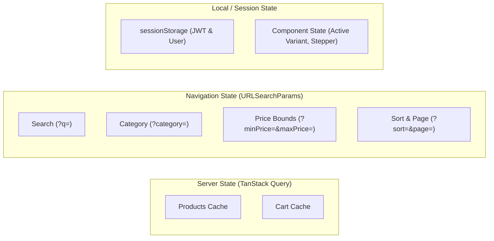

# E-Commerce Frontend Application

A responsive, high-performance e-commerce Single-Page Application (SPA) built with **React 19**, **TypeScript**, **Vite**, **Tailwind CSS v4**, and **TanStack Query v5**.

The client is designed around server-state synchronization, zero client-side price computation, URL-driven catalog navigation, and transparent stale-cart feedback.

---

## Tech Stack

| Technology | Version | Purpose |
| :--- | :--- | :--- |
| **React** | 19.2 | Core UI library using modern hooks and concurrent rendering |
| **TypeScript** | ~6.0 | Strict type safety across components, API contracts, and domain models |
| **Vite** | 8.3 | Lightning-fast HMR and optimized production bundling |
| **Tailwind CSS** | 4.3 | Utility-first styling via `@tailwindcss/vite` |
| **TanStack Query** | 5.104 | Server-state caching, background revalidation, and mutation management |
| **React Router** | 7.18 | Client-side routing with nested layouts and route-level state |
| **Axios** | 1.20 | HTTP client with centralized auth, header, and error interceptors |
| **Vitest** | 5.0 | Unit and integration testing for utilities, adapters, and normalization |

---

## Project Structure

```text
frontend/src/
├── app/                  # Application root, routing, and top-level providers
│   ├── config/           # Environment configuration (VITE_API_BASE_URL)
│   ├── providers/        # QueryClientProvider, AuthProvider, ErrorBoundary
│   └── router/           # React Router v7 routes definition
├── components/           # Reusable presentational components
│   ├── common/           # ProductCard, ErrorBoundary, ImageWithFallback
│   ├── layout/           # SiteHeader, SiteLayout, TopBar, CategoryNav, MobileMenu
│   └── ui/               # QuantityStepper, EmptyState, ErrorState, Skeletons, Icons
├── constants/            # Static navigation items, categories, hero copy
├── errors/               # Normalized ApiError hierarchy, error logging
├── features/             # Feature-based business logic & domain hooks
│   ├── auth/             # AuthContext, AuthProvider, useAuth
│   ├── cart/             # useCart, useAddToCart, update/remove mutations
│   ├── catalog/          # useProducts, useProduct, filters, pagination
│   └── orders/           # Session-based order confirmation storage
├── hooks/                # Generic hooks (e.g. useDebouncedCallback)
├── pages/                # Route page views (Home, Catalog, Detail, Cart, Login, Order)
├── query/                # TanStack Query keys factory
├── services/             # API layer
│   ├── api/client.ts     # Axios instance, Bearer token injection, 401 interceptor
│   ├── auth/             # Session storage and token subscription
│   └── endpoints/        # Auth, Products, Cart, Orders API adapters & normalizers
├── types/                # TypeScript domain types (Product, Variant, Cart, Order)
└── utils/                # Money formatting, URL search params parsing, redirects
```

---

## Getting Started

### 1. Installation

```bash
cd frontend
npm install
```

### 2. Environment Configuration

The application expects `VITE_API_BASE_URL` pointing to the backend API:

```env
# .env.development (loaded automatically during `npm run dev`)
VITE_API_BASE_URL=http://localhost:5000
```

### 3. Available Scripts

```bash
npm run dev      # Start local dev server with Vite HMR
npm run build    # Type-check with tsc and create production bundle
npm run test     # Run all unit/integration tests with Vitest
npm run lint     # Run ESLint across source files
npm run preview  # Preview the production build locally
```

---

## Major Architectural Decisions

### 1. Application State Management

Rather than introducing heavy client-side state stores (such as Redux or Zustand), state is separated into three distinct, specialized layers:



#### A. Server State (TanStack React Query v5)
- All remote data (catalog items, product details, cart contents) lives in React Query.
- **Cache Strategy**: Default `staleTime: 60s`, `gcTime: 5m`, background refetch on network reconnect.
- **Declarative Invalidation**: Mutations (`useAddToCart`, `useUpdateCartItem`, `useRemoveCartItem`, `useCheckout`) automatically invalidate target query keys (`queryKeys.cart`, `queryKeys.products.all`), keeping client views in sync with the database.

#### B. URL as Single Source of Truth for Catalog State
- All product filtering parameters (`q`, `category`, `minPrice`, `maxPrice`, `sort`, `page`) are serialized directly into browser `URLSearchParams` via [`listing-params.ts`](file:///d:/bictree%20assignment/ecommerce/frontend/src/utils/listing-params.ts).
- **Benefits**:
  - Every filter combination is shareable and bookmarkable.
  - Native browser back and forward navigation works out-of-the-box.
  - Eliminates state synchronization bugs between client stores and router history.

#### C. Local UI State
- Transient interaction states (quantity steppers, selected variant attributes, mobile drawer toggles) remain localized within components via `useState` and `useReducer`.

---

### 2. Authentication & Session Choices

#### `sessionStorage` vs `localStorage`
- **Scoped Lifetime**: JWT access tokens and user profile summaries are stored in `sessionStorage` rather than `localStorage`.
- **Rationale**: Scoping credentials to the active browser tab prevents stale token collisions across tabs, guarantees automatic session termination when the tab closes, and minimizes token persistence against script-based extraction.

#### Stateless Pub/Sub Auth Context
- [`session.ts`](file:///d:/bictree%20assignment/ecommerce/frontend/src/services/auth/session.ts) exposes a lightweight subscriber pattern (`subscribeSession`).
- [`AuthProvider`](file:///d:/bictree%20assignment/ecommerce/frontend/src/features/auth/AuthProvider.tsx) listens to session changes and updates React context seamlessly without requiring heavy state libraries.

#### Centralized Axios Interceptors
- **Request Interceptor**: Automatically pulls the current token from `getAccessToken()` and attaches `Authorization: Bearer <token>`, along with a unique `X-Request-Id` header for end-to-end distributed tracing.
- **Automatic 401 Handling**: When an authenticated request encounters a `401 Unauthorized` response (e.g. token expired or user deleted), the response interceptor triggers `setUnauthorizedHandler()`, clearing `sessionStorage` and safely redirecting the user to `/login` with target route preservation (`state: { from: currentPath }`).

---

### 3. Cart & Stale-Stock Handling in the UI

The frontend actively surfaces backend inventory changes without mutating user intent:

- **Dynamic Availability Flags**: Cart line items consume `available` and `stock` from the backend's live stock join:
  - If a variant is out of stock: displays an inline alert *"This item is no longer available."*
  - If stock dropped below requested quantity: displays *"Only X left. Lower the quantity before checkout."*
- **Checkout Guard**: The `Checkout` button is conditionally disabled via [`canCheckout(cart)`](file:///d:/bictree%20assignment/ecommerce/frontend/src/services/endpoints/normalize-cart.ts#L103), which verifies:
  $$\text{items.length} > 0 \land \forall \text{line}: (\text{line.available} \land 0 < \text{line.qty} \le \text{line.stock})$$
- **Zero Client-Side Price Calculation**: All subtotals and totals are normalized from backend responses; the frontend never computes or sends prices to the order endpoint.

---

### 4. API Client & Resilient Error Handling

- **Error Normalization**: Backend responses formatted as `{ success: false, error: { code, message } }` are transformed by [`normalize-api-error.ts`](file:///d:/bictree%20assignment/ecommerce/frontend/src/errors/normalize-api-error.ts) into typed `ApiError` instances with fallback HTTP status messages.
- **Global Error Boundary**: Wraps the entire app in [`AppProviders.tsx`](file:///d:/bictree%20assignment/ecommerce/frontend/src/app/providers/AppProviders.tsx) to catch rendering crashes and offer a one-click reload without losing routing context.
- **Skeleton Loaders**: Dedicated skeleton states ([`ProductGridSkeleton.tsx`](file:///d:/bictree%20assignment/ecommerce/frontend/src/components/ui/ProductGridSkeleton.tsx), `CartSkeleton`) prevent layout shifts during async queries.

---

## Route Overview

All routes are nested inside [`SiteLayout`](file:///d:/bictree%20assignment/ecommerce/frontend/src/components/layout/SiteLayout.tsx) (providing TopBar, SiteHeader with search/cart count, and SiteFooter):

| Route Path | View Component | Description |
| :--- | :--- | :--- |
| `/` | `HomePage` | Hero section, category navigation, brand carousels, and deals |
| `/products` | `ProductListPage` | Filterable catalog with search, price sliders, sorting & pagination |
| `/products/:slug` | `ProductDetailPage` | Product gallery, variant selector (color/size/specs), stock badge, and add-to-cart |
| `/cart` | `CartPage` | Line items list, quantity stepper, stock warnings, subtotal, and checkout |
| `/orders/:orderId` | `OrderConfirmationPage` | Order success receipt restored from sessionStorage |
| `/login` | `LoginPage` | Email and password sign-in with redirect recovery |
| `*` | `NotFoundPage` | 404 fallback with navigation back to catalog |
